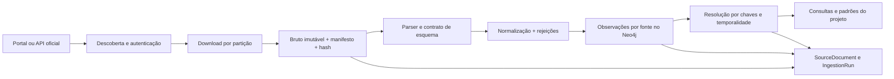

# Arquitetura e critérios de implementação das fontes

Data do planejamento: 2026-10-27. Este documento define trabalho a executar.
Uma ficha de planejamento não certifica disponibilidade do portal nem carga concluída.
O [índice](README.md) e as fichas individuais cobrem todas as entradas do registro,
inclusive portais de descoberta, fontes derivadas e sistemas restritos.

## Resultado esperado

Para cada fonte: obter o dado por um canal documentado, preservar o arquivo bruto,
normalizar segundo um contrato versionado, cadastrar observações no Neo4j e
produzir somente as ligações justificadas por identificadores e evidências.
Cada execução deve informar período, jurisdição, arquivos, registros aceitos,
rejeitados, entidades cadastradas, vínculos confirmados e pendências de ligação.

O resultado deve distinguir quatro entregas: implementação do conector, primeiro
download validado, primeira carga validada e cruzamentos validados. A existência
de um módulo Python não comprova as três últimas entregas.

## Etapa zero: fundação comum

Estes itens precedem qualquer carga ampla. Seus caminhos são entregáveis
propostos, exceto os arquivos atuais indicados como evidência.

| Item | Trabalho concreto | Evidência atual | Critério de aceite |
|---|---|---|---|
| F01 — IDs de fontes | Criar mapa versionado entre `source_id` do catálogo, nome do runner e identificador legado do provedor; armazenar os três explicitamente | `etl/src/bracc_etl/runner.py`, `etl/src/bracc_etl/base.py` e módulos de pipelines | Cada módulo resolve para um único ID do catálogo; execuções históricas continuam rastreáveis |
| F02 — Documentos | Separar normalização de CPF e CNPJ; suportar CNPJ alfanumérico em ETL, API e validações de interface; tratar CPF parcial como observação de identidade | `document_formatting.py` remove letras; `intelligence_provider.py` usa regex de 14 dígitos e rejeita CNPJ alfanumérico | Fixtures numéricas/alfanuméricas passam; empresa alfanumérica é recuperada e analisada pelo endpoint, inclusive resolução por ID; nenhum zero/letra desaparece |
| F03 — Migração de identidade | Introduzir chave canônica paralela, auditar colisões, fazer leitores aceitarem transição e só então promover a chave; preservar IDs e arestas antigas | Uso misto de CNPJ com e sem pontuação entre pipelines | Ensaio de migração em cópia do grafo, relatório de colisões, reversão e comparação de contagens aprovados |
| F04 — Esquema | Reconciliar `infra/neo4j/init.cypher` e `api/src/bracc/queries/schema_init.cypher`; criar constraints para todas as chaves usadas e aprovar labels novas | Os dois arquivos têm conjuntos diferentes de constraints; `Payment` e labels de séries/geografia precisam de desenho explícito | Inicialização limpa e atualização de grafo existente resultam nas mesmas constraints; ingestão duplicada não duplica entidades |
| F05 — Aquisição | Implementar biblioteca de manifesto, HTTP/FTP/exportação, retry limitado, backoff, retomada, checksum, paginação e limites por host | `scripts/bootstrap_all/adapters/registry.py`, downloaders em `etl/scripts/` | Interrupção no meio de uma partição retoma sem corromper artefato ou saltar páginas; login HTML não passa por JSON/CSV |
| F06 — Escrita e métricas | Fazer o loader confirmar transações, propagar erro ao esgotar retries e medir escritas reais, não apenas linhas tentadas | `etl/src/bracc_etl/loader.py` pode saltar lote após retries; `Pipeline.run` pode terminar sem dados e marcar `loaded` | Falha em lote falha a execução; contadores discriminam tentativas, rejeições, nós, arestas e não resolvidos; vazio só é aceito com justificativa verificável |
| F07 — Ligações | Substituir ou implementar os hooks referenciados e ausentes; separar vínculo exato de candidato; adicionar evidência e validade temporal | `linking_hooks.py` procura `scripts/link_persons.cypher` e `scripts/link_partners_probable.cypher`, ausentes no inventário auditado | Hook ausente gera falha explícita ou estado de ligação pendente; homônimos não são unidos; queries de padrão usam evidência rastreável |
| F08 — Orquestração | Atualizar contrato de bootstrap para os 47 módulos atuais, eliminar comandos de scripts inexistentes e cadastrar novas fontes somente após seus testes | `config/bootstrap_all_contract.yml` ainda declara 45; comandos de Comprasnet e DATASUS apontam a arquivos ausentes | Catálogo, runner e contrato concordam; `doctor` valida existência de comandos/inputs sem iniciar uma carga nem resetar o grafo |
| F09 — Dimensões | Materializar geografia IBGE, órgão/UG/ente, moedas/unidades, CNAE e demais vocabulários efetivamente usados | A maioria das ligações atuais concentra-se em `Company` e `Person`; agregados requerem dimensões próprias | Código IBGE, UF, exercício, versão territorial e unidade são verificáveis; nenhum agregado vira pessoa ou empresa por inferência |
| F10 — Ambiente e evidência | Disponibilizar configuração coerente nos contêineres; obter credenciais pelos canais exigidos; definir disco/RAM e medir uma partição antes de ampliar | Configuração Compose e placeholders já registrados no diagnóstico do projeto | Preflight mostra capacidade, acessos e destino; amostra representativa mede bytes/linha e custo; nenhum segredo aparece em logs ou manifestos |

As divergências acima são achados de inspeção de código, não correções já
implementadas por este plano. Os estados `loaded` herdados do CSV permanecem
referências históricas até haver evidência de execução no ambiente escolhido.

## Contrato comum do conector

As 169 entradas do registro são unidades de planejamento, não 169 downloads
independentes. Compartilhar transporte e cache quando houver o mesmo recurso:
Receita/CNPJ/Simples podem reutilizar o manifesto de release; fontes CGU podem
reutilizar cliente e credencial; séries BCB podem compartilhar catálogo de
metadados. Manter contratos de dados, chaves e resultados separados. Um portal
como Base dos Dados ou Tesouro é um mecanismo de descoberta de recursos, não
uma tabela única para transformar em pessoas ou empresas.

O nome histórico do ID não determina a API: por exemplo, séries de Pix/meios de
pagamento precisam confirmar se vêm de SGS ou de um serviço OData específico.
Também é necessário resolver a distinção entre a fonte chamada `comprasnet` no
projeto e os JSONs de contratos PNCP que o módulo atual consome. A conciliação
deve manter a proveniência e evitar contagem duplicada entre as duas origens.

Separar descoberta, download, parsing, transformação, carga e ligação. Um
pipeline pode consumir exportação autorizada ou um espelho, mas deve registrar
a origem, a data da captura e o motivo da alternativa. Um portal de catálogo
precisa resolver seus recursos de dados antes de gerar um conector de ingestão.

O manifesto proposto para cada partição deve conter:

| Campo | Conteúdo |
|---|---|
| `source_id`, `provider_source_id`, `dataset_id` | Identidade canônica e aliases do provedor |
| `partition`, `period_start`, `period_end`, `coverage` | UF/município/tribunal/competência e abrangência real |
| `source_url`, `final_url`, `retrieved_at`, `published_at` | Origem e datas, sem parâmetros secretos |
| `etag`, `last_modified`, `sha256`, `byte_length` | Identidade e integridade do artefato |
| `format`, `encoding`, `schema_version`, `parser_version` | Contrato reprodutível do arquivo |
| `pagination`, `checkpoint`, `expected_parts`, `completed_parts` | Estado de aquisição e prova de completude |
| `rows_read`, `rows_rejected`, `rows_normalized`, `nodes_written`, `edges_written`, `unmatched` | Reconciliação da execução |
| `license_reference`, `access_profile`, `error_class` | Condições observadas de acesso e causa de bloqueio |

Layout proposto: `data/<source_id>/raw/<release>/<partition>/`,
`data/<source_id>/normalized/<schema_version>/` e
`audit-results/ingestion/<run_id>/`. Adaptadores devem preservar os contratos de
entrada dos pipelines existentes até a migração correspondente ser aprovada.
Os arquivos volumosos continuam fora do Git.

Paginação deve ter ordenação estável e checkpoints por partição. Para dados
mutáveis, usar janela de sobreposição e deduplicação pela chave de negócio;
cursor numérico ou hash de página, isoladamente, não prova completude. Revalidar
content-type, assinatura do arquivo, integridade do ZIP/GZIP/DBF e cabeçalhos.
Um timeout, página de login ou resposta parcial não conta como partição concluída.

### Interface operacional a implementar

F05/F08 devem oferecer operações separadas de `acquire`, `validate`, `load`,
`link`, `status` e `doctor`, todas com `source_id`, seletor de partição e manifesto
explícitos. Esses nomes representam a interface futura; não são comandos já
disponíveis na CLI atual. O `download` existente atende ao fluxo CNPJ e não
equivale a um downloader universal das 169 fontes.

`acquire` deve baixar ou receber exportação autorizada sem escrever entidades;
`validate` deve analisar sem alterar o grafo; `load` deve consumir somente
manifesto aprovado; `link` deve registrar regra/versão e não rebaixar candidatos
a fatos; `status` deve distinguir as quatro entregas; `doctor` deve mostrar
pré-condições sem iniciar backfill. Catálogos retornam recursos descobertos;
fontes derivadas consomem manifestos de dependências; fontes restritas retornam
bloqueio fundamentado ou recebem exportação legitimamente fornecida.

Cada operação retorna `run_id`, contagens, partições concluídas/pendentes e
classificação de erro. Uma execução de `load` deve poder ser repetida com o
mesmo manifesto sem aumentar contagens por duplicação. A opção padrão não
apaga dados, não cria credenciais e não aciona reset global.

## Modelo de cadastro e proveniência

O [modelo de unificação](../unification/canonical-model.md) especializa este
contrato para a integração entre fontes: distingue cadastro por raiz de
estabelecimento, usa identidade estável da aplicação e separa artefato de
observação por registro. `SourceDocument` representa o artefato no contexto de
origem; localização de linha/página fica na observação. Fórmulas genéricas de
`doc_id` por registro nas fichas devem ser adaptadas durante a implementação,
preservando IDs legados como aliases. O [runbook](../unification/migration-runbook.md)
define publicação coerente e migração; esses componentes ainda são propostos.

Reutilizar `Company`, `Partner`, `Person`, `Contract`, `Amendment`, `Sanction`,
`Finance`, `Health`, `Education`, `SourceDocument` e `IngestionRun` quando a
semântica e as chaves coincidirem. Entidades novas indicadas nas fichas são
propostas e exigem migração de esquema e atualização das consultas consumidoras.

Cada registro normalizado deve preservar identificador original, namespace,
hash do conteúdo, versão da fonte e referência ao `SourceDocument`. O
`IngestionRun` precisa de ID sem colisão entre execuções concorrentes. Separar
observação da fonte e entidade canônica evita sobrescrever informação divergente
ou perder a origem quando duas bases descrevem o mesmo contrato ou pessoa.

Registros sem chave ou com esquema inesperado vão para quarentena com motivo;
não recebem uma identidade global inventada. Valores monetários têm moeda,
unidade, competência e representação decimal controlada; estoque, fluxo, valor
contratado, empenhado e pago são medidas distintas.

Para cada nova label, registrar chave natural/composta, política de atualização,
constraint, índices, controle de versões e estratégia de exclusão/correção.
Para cada nova relação, registrar direção, cardinalidade, chaves de ligação,
origem, validade, regra e versão da regra. Nenhum campo `confidence` pode
substituir a evidência documental da ligação.

As dimensões propostas devem convergir para contratos comuns, mesmo que os
provedores usem nomes diferentes:

| Dimensão | Chave canônica proposta | Conteúdo preservado |
|---|---|---|
| `Territory` | `territory_id = sistema:tipo:codigo:versao_territorial` | País/UF/município/recorte, código original, período de validade, geometria ou referência |
| `EconomicActivity` | `activity_id = classificacao:versao:codigo` | CNAE/atividade, nível hierárquico e código original como texto |
| `PublicBody` | `public_body_id = jurisdicao:sistema:identificador:versao` | Ente, órgão, UG/UO, IDs SIAFI/SIORG/estaduais e CNPJ quando houver |

Um município é um `Territory` com tipo município; não criar dimensões paralelas
incompatíveis por pipeline. Identificadores IBGE e códigos municipais da Receita
só se ligam por crosswalk oficial/versionado. Registros de órgão e empresa
podem compartilhar CNPJ, mas seus papéis e identificadores institucionais
permanecem explícitos. Validar essas projeções em uma fixture entre pelo menos
três fontes antes da carga ampla.

## Regras para as coligações

| Situação | Regra obrigatória |
|---|---|
| Empresa | CNPJ canônico exato e validado, mantendo filial e raiz distintos; raiz compartilhada não significa o mesmo estabelecimento |
| Pessoa | CPF completo válido quando legitimamente disponível, ou identificador estável do provedor com namespace; nome isolado não produz `SAME_AS` |
| CPF mascarado | `Partner`/observação própria; gerar candidato com evidências independentes, sem reconstruir dígitos ou promover homônimo a identidade confirmada |
| Mandato/candidatura | ID da casa legislativa ou eleição + `SQ_CANDIDATO`/ano/cargo/UF; vínculo com pessoa exige chave suportada |
| Contrato/licitação | Provedor + esfera/ente/UG + exercício + número/ID oficial; separar contrato, aditivo, empenho, liquidação e pagamento |
| QSA histórico | Relação vale para o snapshot/intervalo observado; quadro societário atual não prova sociedade na data de contrato antigo |
| Sanção e recebimento | Comparar data do evento e intervalo de vigência, tipo/alcance da sanção e identidade exata; não generalizar qualquer sanção a impedimento contratual |
| Emenda e beneficiário | Código da emenda/autor e exercício + beneficiário identificado; benefício, repasse e contrato são eventos diferentes |
| Geografia | Código IBGE e versão territorial; converter códigos de seis/sete posições por tabela de correspondência, não por corte arbitrário |
| Séries e estatísticas | Provedor + tabela/série + variável + recorte + geografia + período + unidade; cruzar contexto territorial/temporal, não inferir relações nominais |
| Ambiente | Interseção espacial com CRS, validade temporal e metodologia; sobreposição não implica propriedade ou responsabilidade sem vínculo cadastral |
| Exterior | ID do provedor e jurisdição; nome parecido gera candidato, sem `SAME_AS` automático com pessoa ou empresa brasileira |
| Justiça | Processo canônico + tribunal/grau; metadados públicos do DataJud não garantem dados de partes; partes de outra origem exigem contrato separado |

As regras globais acima prevalecem sobre qualquer atalho herdado dos pipelines.
Uma relação marcada como `existing` na ficha documenta o comportamento a auditar;
não autoriza preservar um merge por nome ou outra associação fraca encontrada
no código atual.

## Consultas do projeto que precisam funcionar

| Cruzamento | Fontes e bases | Prova de aceite |
|---|---|---|
| Empresas e sócios | CNPJ/QSA, holdings e entidades públicas | Filial/raiz distintas, CPF parcial preservado, histórico de sociedade explícito |
| Contratos e sanções | Transparencia/Comprasnet/PNCP/estados + CEIS/CNEP/TCU | Casos com vigência coincidente e expirada produzem resultados diferentes; referências dos dois lados presentes |
| Emendas e contratos | Transparencia/Transferegov/Tesouro/SIOP + contratos + cadastro de órgãos/autores | Não duplicar o mesmo evento entre provedores; trilha autor → emenda → beneficiário → contrato explicita cada elo |
| Dívida, crédito e contratação | PGFN + BNDES + contratos | Mesma entidade e períodos comparáveis; relação financeira não é conclusão sobre irregularidade |
| Servidores e empresas | Transparencia/SIAPE autorizado + QSA | Não unir homônimos; considerar vigência do cargo e da sociedade |
| Eleições e empresas | TSE, bens, doações, filiação + QSA | Ano e candidatura preservados; eleitorado/urna agregados não identificam voto individual |
| Ambiente e agentes econômicos | IBAMA, CAR/INCRA, PRODES/DETER e cadastro empresarial | CRS e período compatíveis; ligação a proprietário só quando identificador e origem sustentam a relação |
| Serviços e território | CNES/INEP, IBGE, orçamento e estatísticas | Estabelecimento identificado quando disponível; indicadores agregados ligados ao território e à competência |
| Contratação entre esferas | PNCP, MiDES, TCEs e portais estaduais | Namespace impede colisões de números locais; conciliação evita contar contrato uma vez por portal |
| Mercado e grupos econômicos | CVM, fundos, BCB, B3 e QSA | Papéis, emissores, administradores e instrumentos separados; custodiante não vira controlador por inferência |

Revalidar as consultas em `api/src/bracc/queries/public_pattern_*.cypher` e os
padrões em `intelligence_provider.py` após alterações de labels/propriedades.
Um cruzamento é concluído quando há resultado positivo com evidência e caso
negativo que prova que a regra não está fazendo ligação indevida.

### Compatibilidade entre produtores e consultas

No código auditado, `pncp` cadastra publicações em `Bid`, e MiDES usa
`MunicipalContract`/`MUNICIPAL_VENCEU`; as consultas comunitárias de contratação
esperam `Contract`/`VENCEU`. Implementar uma projeção canônica documentada de
observações contratuais municipais para `Contract`, com crosswalk e origem,
antes de disponibilizar esses registros aos padrões. Não projetar uma publicação
PNCP como fornecedor contratado: adquirir os recursos de resultados/contratos e
o vínculo oficial à publicação. O módulo `comprasnet` atual já consome JSONs de
contratos PNCP, o que precisa ser refletido na identidade e conciliação de fontes.

Para padrões de operadores SUS, corrigir o significado de `atende_sus`: o parser
CNES atual considera um indicador ambulatorial e transforma ausência em zero.
Definir categorias ambulatorial/hospitalar/outros canais conforme layout, manter
desconhecido como desconhecido e distinguir mantenedor, operador e estabelecimento.
A consulta deve filtrar o papel e a competência explicitamente.

Para SRP, adquirir atas, órgãos participantes originais e documentos de adesão.
Criar entidades/arestas de adesão com data e evidência. `srp=true` mais contratos
de vários órgãos não comprova que houve carona: separar essa coocorrência da
relação documental de órgão aderente.

Os 21 IDs em `PATTERN_METADATA` não são 21 padrões já disponíveis. Há oito na
allowlist comunitária. Para cada novo padrão, implementar query, parâmetros,
registro e roteamento no provider/tier apropriado, proteção da saída no modo
público e teste pelo endpoint. Testar a presença do arquivo Cypher isoladamente
não prova que o recurso está acessível ao usuário.

## Sequência de entrega por fonte

1. **Contrato confirmado:** URL de dados ou exportação, autenticação, recurso,
   licença/documentação, partição inicial e esquema de exemplo registrados.
2. **Download validado:** uma partição íntegra, manifesto, hash, contagem,
   checkpoint e retomada testados; provar completude daquela partição.
3. **Transformação validada:** fixture representativa, chaves, nulos, datas,
   moedas/unidades, deduplicação e rejeições reconciliados.
4. **Cadastro validado:** constraints aprovadas, escrita confirmada e reexecução
   da mesma partição sem duplicatas; diferenças de versão tratadas.
5. **Coligações validadas:** positivos, homônimos/IDs inválidos, períodos
   incompatíveis e não resolvidos exercitados; evidência consultável no grafo.
6. **Operação validada:** incremental + backfill, monitoramento, alerta por
   mudança de esquema e atualização do estado somente após evidência de sucesso.

O backlog deve ter tarefas independentes para estas seis entregas, com o
`source_id` e a versão do contrato em cada tarefa. `blocked_credentials`,
`blocked_external` e `restricted` são resultados operacionais explícitos, não
sucesso de download ou carga. Catálogos produzem inventários de recursos;
fontes derivadas produzem artefatos a partir das bases dependentes.

## Piloto, escala e atualização

Começar por CNPJ + uma fonte de sanções + um conjunto pequeno de contratos;
depois adicionar uma emenda e uma candidatura. Em paralelo, habilitar uma
dimensão territorial e uma série agregada para provar que o modelo comporta
tanto entidades quanto estatísticas sem misturá-las.

Medir uma partição representativa de cada classe: ZIP/CSV grande, API paginada,
BigQuery, DBF/DBC, PDF/XML, série estatística e camada geoespacial. O piloto deve
medir disco bruto/normalizado/índices, memória máxima, taxa de parsing, custo de
rede/consulta e throughput de escrita. Só então definir lotes, concorrência e
prazo de backfill; não há estimativa confiável de carga integral antes disso.

Após o piloto, seguir a ordem topológica da matriz. Fontes independentes podem
andar em paralelo com limites por host; ligações ficam pendentes até suas bases
necessárias estarem disponíveis. Persistir execução no servidor com logs,
manifestos e checkpoints. Uma falha externa não deve descartar partições válidas
de outras fontes, nem avançar o estado da fonte que falhou.

Retenção e backfill são definidos por fonte: snapshots são arquivados; APIs de
eventos usam watermark + sobreposição; correções/revisões são versionadas;
estatísticas publicadas tardiamente têm rechecagem de competências anteriores.
Nunca usar reset global do grafo como requisito de uma atualização incremental.

## Verificação e evidência de conclusão

Checks de catálogo, fixtures unitárias de parser/normalização, integração Neo4j
descartável, amostra real por fonte, reexecução idempotente e cenários de
cruzamento são camadas diferentes. Registrar o que foi realmente executado.
Teste com mock não comprova disponibilidade externa; HTTP 200 não comprova
dados completos; leitura de arquivo não comprova que relações foram escritas.

Antes de classificar uma fonte como pronta, anexar manifesto, intervalo de
cobertura, rejeições, métricas de escrita, consulta de amostra e relatório de
vínculos não resolvidos. Mudança de esquema deve interromper ou colocar a
partição em quarentena, preservando a versão anterior consultável.

## Referências verificadas para decisões transversais

- [Receita Federal: CNPJ alfanumérico](https://www.gov.br/receitafederal/pt-br/acesso-a-informacao/acoes-e-programas/programas-e-atividades/cnpj-alfanumerico).
- [Receita Federal: primeiro CNPJ alfanumérico em 31/07/2026](https://www.gov.br/receitafederal/pt-br/assuntos/noticias/2026/julho/receita-federal-gera-o-primeiro-cnpj-em-formato-alfanumerico).
- [CNJ: acesso à API pública DataJud](https://datajud-wiki.cnj.jus.br/api-publica/acesso/): consultar a chave pública vigente na documentação; não copiar seu valor para o plano.
- [CNJ: tutorial da API pública DataJud](https://www.cnj.jus.br/wp-content/uploads/2023/05/tutorial-api-publica-datajud-beta.pdf): metadados públicos e proteção dos dados de partes.
- [CNJ: manual SISBAJUD](https://www.cnj.jus.br/wp-content/uploads/2026/05/manual-basico-sisbajud.pdf): perfis de acesso autorizados.
- [Catálogo e proveniência locais](../data-sources.md), [snapshot Brazil Visible](../catalogs/brazil_visible.json) e [registro de fontes](../source_registry_br_v1.csv).

Detalhes de endpoints, portais estaduais e cadências devem ser revalidados no
início de cada implementação. Nas fichas, a coluna de evidência distingue o que
foi visto no código, documentado pelo provedor, apenas catalogado ou ainda
precisa ser validado.
