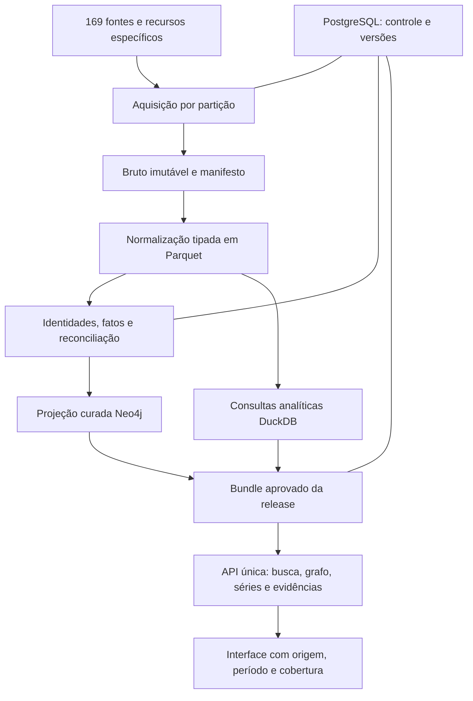

# Plano para unificar as bases do Brasil em Rede

Data: **2026-10-27**. Estado: **planejamento de implementação**.
Escopo: as **169 fontes catalogadas**, seus datasets e as ligações entre eles.
O inventário contém 168 entradas no universo público de planejamento e 47
módulos de pipeline; esses números não certificam cargas ou acesso público.

O resultado esperado é uma plataforma de consulta em que uma empresa, órgão,
contrato ou território mantenha a mesma identidade entre fontes, com origem,
data, cobertura e divergências verificáveis. Os documentos originais e as
observações de cada produtor continuam preservados.

## Entregáveis deste plano

- [Modelo canônico, identidade e regras de ligação](canonical-model.md).
- [Doze etapas, dependências, responsáveis e critérios de aceite](roadmap.md).
- [Mapa individual das 169 fontes em 15 famílias](source-map.md).
- [Procedimento de migração, publicação e reversão](migration-runbook.md).
- [Plano estruturado](../../config/unification_plan.json) e
  [mapa estruturado das fontes](../../config/source_unification_map.json).

Os [planos individuais de aquisição](../implementation/README.md) continuam
definindo como obter cada base. Este plano acrescenta o contrato comum entre
elas. Novos serviços, caminhos e comandos operacionais citados abaixo são
entregáveis futuros; nenhum banco foi migrado ou implantado por estes arquivos.

## Arquitetura proposta



| Componente | Responsabilidade e fronteira |
|---|---|
| Bruto imutável | Guardar bytes recebidos, hash, localização e condições de acesso. Começar com volume local e interface de armazenamento; serviço S3 compatível pode ser adotado quando houver necessidade operacional medida |
| Parquet normalizado | Preservar registros tipados, versões, observações e séries por dataset/partição; fonte reprocessável das projeções |
| PostgreSQL de controle e aplicação | Catalogar recursos e execuções; manter crosswalks de identidade, decisões, leases, outbox, manifests e ponteiro da release. Schema de aplicação separado guarda usuários, investigações e anotações mutáveis; payloads nacionais não são copiados automaticamente para esse banco |
| Neo4j Community | Servir entidades e relações curadas, com fatos/evidência e constraints reconciliadas; manter compatibilidade dos contratos usados pelas consultas existentes |
| DuckDB por processo | Validar e consultar arquivos Parquet explicitamente selecionados pelo manifesto; produzir estatísticas e resultados analíticos sob limites de recursos |
| FastAPI e React existentes | Oferecer uma entrada de consulta e indicar release, origem, período, conflitos e limites da cobertura |

**Decisão de projeto:** PostgreSQL passa a ser a autoridade do controle
operacional; Parquet preserva as observações; Neo4j e resultados analíticos são
projeções reconstruíveis de um bundle aprovado. Essa separação evita que uma
falha do grafo elimine o histórico necessário para reprocessá-lo.

O protótipo local pode usar `data/unified/`, ignorado pelo Git, para os volumes
brutos e normalizados. A implantação deve configurar e proteger volumes próprios;
manifests e logs não carregam credenciais. Estado mutável de usuários e
investigações será migrado do grafo para o schema de aplicação antes de congelar
as projeções; rebuild de datasets não deve apagar trabalho do usuário.

A documentação do [PostgreSQL descreve UPSERT atômico](https://www.postgresql.org/docs/current/sql-insert.html)
e [isolamento transacional](https://www.postgresql.org/docs/current/transaction-iso.html).
A proposta usa essas capacidades para unicidade e coordenação local; não há
uma transação automática abrangendo PostgreSQL, arquivos e Neo4j. O protocolo
de publicação entre os componentes está no [runbook](migration-runbook.md).

O [DuckDB lê Parquet com projeção e filtros](https://duckdb.org/docs/lts/data/parquet/overview).
Será usado por processo sobre releases imutáveis. A
[documentação de concorrência](https://duckdb.org/docs/current/connect/concurrency)
possui diferentes modos de implantação; compartilhar um arquivo DuckDB gravável
entre workers não faz parte desta proposta.

Esta arquitetura deve ser validada no piloto. Não se propõe instalar Kafka,
Spark, cluster de grafo ou banco vetorial nesta etapa. A extensão futura depende
de gargalo medido, custo e requisito que os componentes acima não atendam.

## Lacunas confirmadas no código atual

| Evidência | Efeito na unificação | Trabalho correspondente |
|---|---|---|
| `cnpj.py` seleciona primeiro estabelecimento por raiz e usa fallback com sufixo `000100` | Pode perder filiais e criar documento não comprovado | Separar raiz/estabelecimento e eliminar fallback na U02/U04 |
| `Partner.partner_id` deriva de nome/documento parcial/tipo sem contexto da empresa | Homônimos podem virar a mesma entidade | Observação local de sócio e resolução forte na U02/U06 |
| `document_formatting.py` remove letras | Perde identidade alfanumérica e aceita formas incompletas | Contrato de documentos na U02 |
| `SOCIO_DE` histórico é reconstruído globalmente por última ocorrência | Pode apagar vínculos de outra partição e preservar sócios ausentes de snapshot novo | Reconciliação de snapshots completos na U05/U06 |
| Consultas/serializers expõem `elementId` e dependem da ordem de labels | Rebuild pode quebrar referências e novos labels podem mudar o tipo apresentado | IDs da aplicação e resolução explícita do tipo na U02/U10 |
| `loader.py` pode saltar lote após retries; métricas contam linhas tentadas | Parte da carga pode receber aparência de sucesso | Transações confirmadas e gate de publicação na U07 |
| `SourceDocument` não é contrato uniforme de todos os pipelines | Falta rastrear a origem de cada atributo/relação | Observações e evidências na U05 |
| PNCP, Comprasnet e MiDES usam modelos diferentes | Licitação pode ser confundida com contrato, e espelhos podem duplicar valores | Chaves e papéis reconciliados na U06/U08 |
| Os inicializadores de esquema diferem | Entidades novas podem entrar sem a constraint prevista | Migração versionada única na U07 |
| `backup-neo4j.sh` tenta dump no contêiner em execução | Backup não comprova recuperação da instalação Community | Backup offline e restore ensaiado na U11 |

Evidências locais: [CNPJ](../../etl/src/bracc_etl/pipelines/cnpj.py),
[loader](../../etl/src/bracc_etl/loader.py), [base](../../etl/src/bracc_etl/base.py),
[API pública](../../api/src/bracc/routers/public.py),
[esquema API](../../api/src/bracc/queries/schema_init.cypher),
[esquema infraestrutura](../../infra/neo4j/init.cypher) e
[backup herdado](../../infra/scripts/backup-neo4j.sh).
São achados de inspeção; o plano não os marca como corrigidos.

## Critérios globais de integração

1. **Cobertura do plano:** 169 IDs únicos têm família, grão, chaves, destino,
   bloqueios e ficha de aquisição. Estado de planejamento fica separado do
   estado de execução.
2. **Identidade:** documentos preservam zeros e letras; filial, raiz, órgão,
   pessoa e papel institucional não são confundidos. Nome, máscara ou valor
   monetário não bastam para confirmar identidade.
3. **Origem:** toda afirmação publicada localiza fonte, revisão, artefato e
   registro; informação legada sem evidência fica identificada e fora de
   cruzamentos que exijam confirmação.
4. **Contagens:** registros lidos se reconciliam com aceitos, duplicatas e
   rejeições segundo o grão do parser. Métricas de linhas, fatos e escritas
   são distintas. Quantidades sem chave ou ligação ficam explícitas.
5. **Reexecução:** o mesmo manifesto e contrato não geram fatos duplicados.
   Uma falha interrompe a promoção da partição/release.
6. **Consistência:** a API fixa um único bundle no início da requisição e o
   mantém nos cursores e expansões encadeadas; grafo, analytics, esquema e
   versão de resolução correspondem a ele. Estado mutável da aplicação tem
   revisão própria e não é parte do snapshot dos datasets.
7. **Temporalidade:** data de captura não vira data do evento; snapshot atual
   não comprova sociedade ou sanção num contrato antigo.
8. **Acesso:** cada contrato determina campos e uso permitidos. Fontes restritas
   não entram na projeção pública; catálogo de descoberta não conta como carga.
9. **Recuperação:** reconstrução, restore e rollback preservam IDs públicos e
   têm ensaio verificável antes de qualquer corte.

Os limites de rejeição, frescor, latência, custo e disponibilidade são definidos
por contrato no piloto. Chaves duplicadas indevidas, evidência ausente em fato
publicado e mistura de releases têm tolerância zero. Não se assume que 100% das
linhas de toda fonte sejam ligáveis ou que todas as fontes estejam disponíveis.

## Primeiro resultado utilizável

Entregar **CNPJ → sanções → contratos**, incluindo uma matriz e duas filiais,
um homônimo com documento parcial e um contrato observado em duas origens.
O usuário deve consultar a empresa e abrir o vínculo com fonte, data e cobertura.
Complementar o piloto com **uma dimensão IBGE e uma série agregada** para provar
que a plataforma também integra estatísticas sem criar identidades nominais.

Somente depois desse aceite executar as oito ondas do
[plano das fontes](../implementation/source_matrix.csv), com os estados por
dataset/partição. Os 21 planos de cruzamentos exigem seus próprios gates de
dados e testes de endpoint; não são 21 recursos operacionais já disponíveis.

## Capacidade e estimativa

U01 deve medir o inventário real do ambiente: bancos/volumes existentes,
versões, contagens, tamanho, constraints e cobertura. U08/U09 medem uma partição
representativa por formato e domínio antes de estimar expansão.

Reservar separadamente bruto retido, Parquet versionado, índices do PostgreSQL,
grafo ativo, grafo candidato, temporários de normalização e backup restaurável.
O espaço mínimo é a soma medida dessas parcelas mais margem operacional
documentada. A publicação por instância candidata exige capacidade para manter
as duas projeções; sem isso, planejar janela de manutenção e recuperação.

O [roadmap](roadmap.md) usa esforço relativo M/L/XL. Datas e custo de carga
nacional só serão definidos após medição, acesso às fontes e disponibilidade
da equipe. Papéis indicados não representam pessoas já designadas.

## Como verificar estes artefatos

```bash
python3 scripts/generate_unification_plan.py --check
python3 scripts/generate_source_implementation_plan.py --check
```

O primeiro comando confere cobertura, modos, famílias, dependências, referências
locais e documentação gerada. Nenhum deles inicia bancos ou coleta dados.
