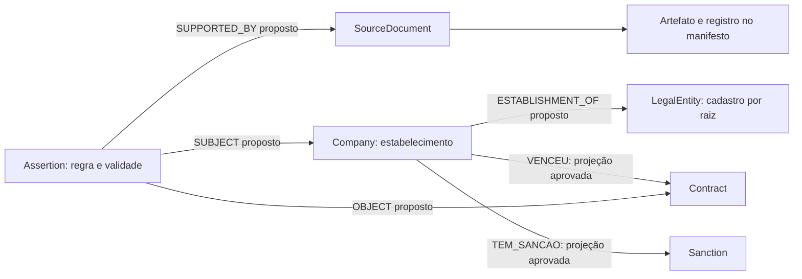

# Modelo comum: identidades, observações e fatos

Estado: proposta a implementar nas etapas U02, U05, U06 e U07 do
[plano de unificação](README.md). As labels existentes continuam observações
de origem até sua migração; as novas labels abaixo não estão implementadas.

## Identidade da entidade e identidade do registro

`entity_id` será um UUID opaco gerado pela aplicação e persistido no registro
de identidades. Ele não depende do ID interno do grafo, do nome ou do hash de
um documento pessoal. O mesmo identificador forte aprovado resolve para a mesma
entidade, mesmo após reconstruir a projeção.

Um identificador é uma tupla `(namespace, tipo, valor normalizado, escopo)`.
O escopo pode incluir país, tribunal/grau, eleição, emissor ou versão territorial.
A versão da regra de normalização é guardada no crosswalk; uma nova regra não
apaga nem redistribui IDs antigos automaticamente. CPF completo e aliases
legados sensíveis ficam em armazenamento de acesso controlado e não são
expostos como IDs públicos enumeráveis.

O uso atual de `elementId` exige transição. O
[manual do Neo4j recomenda IDs gerados pela aplicação](https://neo4j.com/docs/cypher-manual/5/functions/scalar/#functions-elementid)
e limita as garantias do mapeamento de IDs internos. A proposta mantém aliases
legados no escopo do snapshot de origem, migra consumidores e só depois remove
o fallback. Adicionar uma superlabel comum também exige substituir `labels[0]`
por seleção explícita do tipo de domínio em serializers e consultas.

| Entidade ou fato | Grão e chave de origem | Regra de integração |
|---|---|---|
| `LegalEntity` proposta | Cadastro RFB por raiz de oito caracteres | Representa o cadastro agregado por raiz; natureza jurídica e escopo são preservados. Não significa grupo econômico nem comprova personalidade jurídica em todos os tipos cadastrais |
| `Company` preservada | Estabelecimento por CNPJ completo de 14 posições | Matriz e filiais são entidades distintas ligadas ao cadastro por raiz; sufixo nunca é fabricado |
| `Person` preservada | Documento íntegro validado no namespace ou crosswalk oficial comprovado | ID de candidato/parlamentar identifica um registro de seu emissor; ligação global requer evidência suficiente |
| `Partner` / observação de sócio | Fonte + dataset + empresa/raiz observada + chave da linha + revisão | Nome/CPF parcial fica contextualizado. Não atribuir o QSA por raiz à primeira filial encontrada |
| `PublicBody` proposta | Namespace institucional + código de órgão/UG/ente + vigência | CNPJ, código SIAFI, órgão e unidade têm crosswalk e papéis distintos; órgão não se resolve pelo nome |
| `Territory` proposta | Sistema + tipo + código + versão territorial | Códigos IBGE e do produtor têm correspondência oficial; mudança de limite não altera o passado |
| `EconomicActivity` proposta | Sistema de classificação + versão + código | CNAE como dimensão; estatística por CNAE não é propriedade de uma empresa individual |
| `Bid` / licitação | ID oficial da publicação/procedimento, com emissor e exercício | Não implica vencedor nem existência de contrato |
| `Contract` canônico | Identificador oficial de contrato + emissor/ente + exercício quando necessário | Espelhos mantêm observações próprias; unificação exige ID compartilhado ou crosswalk demonstrado |
| Aditivo, item e pagamento | ID próprio + vínculo ao contrato + parcela/revisão quando aplicável | Não somar item, valor total e pagamento como se fossem a mesma medida |
| `Sanction` e eventos administrativos | Autoridade + identificador da decisão/registro + sujeito e escopo | Preservar natureza, status, jurisdição e vigência; processo ou menção não é sanção confirmada |
| Candidatura e doação | Pleito + SQ_CANDIDATO; receita por ID oficial/prestação | Pessoa, candidatura e transação são grãos diferentes; doador/candidato/ano não é chave da receita |
| Saúde/educação | CNES, escola/IES/curso e namespace + competência | Cadastro, operador/mantenedor e indicadores têm observações distintas |
| Série e observação estatística | Provedor + tabela/série + variável + categorias + território + período + revisão | Unidade, frequência, ajustes e população de referência acompanham a medida |
| Documento e ato | Fonte + artefato/edição + ID do ato + revisão | Texto e menção preservam página/trecho; extrair nome não confirma pessoa ou relação |

O [leiaute oficial da RFB](https://normas.receita.fazenda.gov.br/sijut2consulta/anexoOutros.action?idArquivoBinario=76204)
mantém 14 posições no CNPJ: oito da raiz, quatro do estabelecimento e duas
verificadoras; raiz e ordem podem ser alfanuméricas. Aplicar validação do
contrato oficial antes de vincular. Não completar zeros/letras ausentes a
partir de aproximação. A string original permanece na observação.

O QSA por raiz se liga ao cadastro `LegalEntity`; a consulta de um estabelecimento
pode percorrer esse cadastro para apresentar a sociedade observada. Não copiar
automaticamente uma participação para cada filial como se a fonte tivesse
publicado vínculos independentes. Consultas legadas que esperam `SOCIO_DE`
diretamente em `Company` precisam adaptar a travessia e exibir esse escopo.

Um `PublicBody` com código de UG ou órgão não se funde ao `Company` apenas por
compartilhar CNPJ. O documento aponta ao estabelecimento registral; a relação
institucional guarda papel e vigência. O índice de identificadores considera
o tipo da entidade e seu namespace para impedir fusão entre papéis distintos.

## Envelope normalizado por registro

Cada dataset terá contrato versionado de payload e grão; o envelope comum
acompanha qualquer registro nominal, série ou documento extraído:

| Campo | Semântica proposta |
|---|---|
| `source_id`, `provider_source_id`, `dataset_id` | ID canônico do catálogo, alias do provedor e recurso específico |
| `source_record_key`, `record_id` | Chave de negócio original e identidade estável do registro dentro de seu namespace; não é chave global de pessoa |
| `observation_id` | Hash versionado da tupla dataset/registro/revisão da fonte/conteúdo normalizado/versão do contrato; não inclui relógio da reexecução |
| `artifact_id`, `artifact_sha256`, `record_locator` | Artefato íntegro e posição no bruto: membro do ZIP, linha lógica, página/trecho ou caminho JSON |
| `source_release`, `partition_id`, `coverage` | Release do produtor, partição e cobertura realmente adquirida |
| `schema_version`, `parser_version`, `normalizer_version` | Contratos necessários para reproduzir o resultado |
| `payload`, `identity_refs` | Campos tipados de domínio e referências de identidade que ainda podem estar não resolvidas |
| `event_at`, `valid_from`, `valid_to`, `date_precision` | Tempo do evento/vigência e precisão; desconhecido permanece nulo |
| `published_at`, `retrieved_at`, `ingested_at` | Publicação, captura e processamento, sem substituir a data do fato |
| `run_id`, `access_profile`, `license_reference` | Execução, classe de acesso e referência observada da fonte |

Uma execução recebe UUID próprio; a identidade da observação é determinística
para o mesmo conteúdo e contrato. Separar `run_attempt` de `observation_id`
permite contabilizar retries sem multiplicar os fatos.

Bytes iguais podem compartilhar armazenamento físico, mas suas aquisições,
fontes e permissões continuam distintas. `SourceDocument` representa o artefato
naquele contexto de origem; o registro é localizado pelo envelope. Não criar
automaticamente um documento inteiro por linha de CSV.

Essa granularidade especializa propostas genéricas anteriores nas fichas.
IDs `doc_id` legados são preservados como aliases; contratos individuais devem
adotar esta distinção durante sua implementação, sem alterar silenciosamente
a origem dos fatos já existentes.

## Fonte, afirmação e projeção

O mesmo contrato pode aparecer em PNCP, portal local e MiDES. Guardar três
observações de origem e produzir um evento canônico somente quando houver
identificador oficial ou crosswalk verificável. Havendo dúvida, manter os
eventos separados com estado de reconciliação, sem somar uma contagem deduplicada
como se fosse confirmada.

Uma afirmação sobre entidade ou relação deve conter sujeito, predicado,
objeto/valor tipado, período, observações de suporte, regra e versão. A label
`Assertion` é proposta para a evidência dos fatos projetados no grafo; payloads
e observações volumosos permanecem em Parquet com índice de localização.

As relações diretas usadas por consultas são projeções materializadas das
afirmações aprovadas. Os nomes novos do diagrama são contratos propostos;
F04/U07 definem constraints e atualizam consumidores antes de ativá-los.
Múltiplas evidências não criam múltiplos contratos, mas continuam acessíveis.

Valores monetários usam decimal exato e moeda/escala declaradas; representação
em unidades mínimas só quando o contrato define a escala e cabe no tipo de
destino. Não converter ausente em zero, nem capital social em patrimônio pessoal.
Datas com precisão diária não recebem hora fictícia. Intervalos têm regra
documentada de limites e não usam a data da captura como início da vigência.

## Resolução, divergências e correções

- **Exato:** documento íntegro validado ou ID oficial no mesmo escopo, com
  evidência e papel compatíveis, pode confirmar a ligação.
- **Candidato:** similaridade de nome, máscara, endereço ou modelo probabilístico
  apenas abre revisão; score não substitui evidência e não entra em padrão factual.
- **Conflito:** identificadores, datas ou papéis incompatíveis ficam separados e
  auditáveis; não escolher por ordem de carga.
- **Não resolvido:** fato permanece válido em sua origem quando a entidade global
  é desconhecida; filas e métricas explicitam o que falta.

Definir política de valor exibido por campo: autoridade da fonte para aquele
atributo, vigência pertinente, revisão e estado de qualidade. A decisão guarda
regra, versão e observação escolhida; outras alegações continuam consultáveis
conforme acesso. Um nome cadastral atual não sobrescreve a razão social histórica
do documento de um contrato. Um conflito material impede confirmação automática.

Merge e split de identidade são eventos reversíveis com aliases, entidades
afetadas e reprocessamento dos fatos dependentes. Não usar fusão destrutiva do
grafo como mecanismo padrão de deduplicação. Decisões de identidade também têm
versão fixada no bundle da consulta.

No QSA, ausência em um snapshot integral pode encerrar a projeção de presença
observada naquela data; não prova a data legal de saída. Ausência numa partição
incompleta não encerra vínculo algum. Atualizar somente o escopo coberto, com
marcador de completude, preservando snapshots anteriores e relações de outras
fontes. O mesmo cuidado se aplica a revogação de sanção e exclusão de cadastro.

## Estatística, geografia e fronteira pública

Uma linha agregada liga variável, território, período e unidade. Não identifica
trabalhador, paciente, eleitor ou beneficiário a partir do agregado. Totais e
subcategorias não são somados juntos sem regra; revisões da competência substituem
a versão selecionada, mantendo a anterior disponível no histórico.

Geometrias preservam CRS, versão e método de interseção. Proximidade ou interseção
não comprova propriedade, autoria de evento ou infração. Crosswalk municipal do
produtor para IBGE precisa de evidência; igualdade de nomes não basta.

A projeção pública recebe apenas os campos e fatos permitidos pelo contrato.
Dados institucionais restritos, se um dia houver acesso autorizado, usam outro
ambiente, credenciais e volumes; um filtro por label na API não fornece essa
segregação. Revisões de publicação precisam abranger também bruto, normalizado,
aliases, evidências e resultados de analytics.
